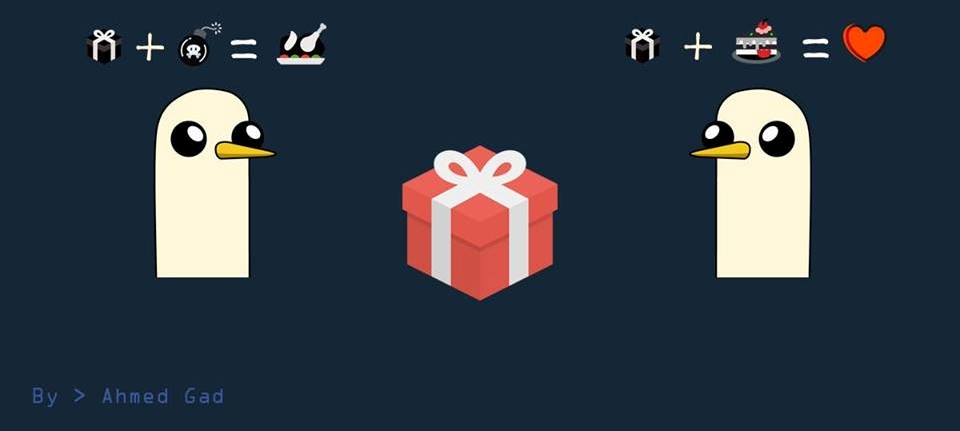

## Ahmed Gad  
**Senior Frontend Developer & UX/UI Specialist**

Building scalable, high-performance web applications and design systems with a strong focus on usability, accessibility, and clean architecture.

### 👨‍💻 What I do
- Frontend architecture for large-scale web apps  
- UX/UI design systems & component libraries  
- E-commerce solutions (Magento & custom storefronts)  
- Mentoring developers & leading frontend teams
- ERP frontend development & enterprise system integration (Odoo & custom ERP solutions)

### 🏢 Experience
- **Senior Frontend & UX/UI Developer @ Raneen**
  - Full-time, remote · Oct 2025 - Present
  - Earlier listed role: Full-time, remote · Feb 2025 - Dec 2025
- **Senior Frontend Developer @ stc**  
  Full-time, remote · Nov 2022 - Dec 2025
- **Course Instructor @ Teradevelopers**  
  Part-time · Jan 2020 - Nov 2025
- **Frontend & UX Team Lead @ zumurudat**  
  Part-time · Jun 2024 - Aug 2025
- **Senior Frontend Developer @ RUSHBRUSH, INC.**  
  Full-time · Oct 2021 - Oct 2022
- **Senior Frontend Developer @ tech2**
  - Part-time · Oct 2021 - Apr 2022
  - Full-time · Jan 2020 - Jan 2022
- **Frontend Developer @ IEREK**  
  Full-time · Mar 2019 - Oct 2019
- **Frontend Developer @ Freelancer.com**  
  Freelance · Dec 2015 - Jan 2019
- **Frontend Developer @ Seven Tech**  
  Full-time · Oct 2017 - Aug 2018
- **Production Technician & Repair Technician @ El Sewedy Electrometer Group**  
  Sep 2015 - Jul 2016

### 💡 Expertise
- Angular (Enterprise-level apps)  
- React / Next.js  
- UI Architecture & Design Systems  
- Performance optimization & clean code  

### 💬 Ask me about
Frontend Architecture • UX/UI • Web & Mobile Design • E-commerce Frontends

### 📫 Reach me
- LinkedIn: https://www.linkedin.com/in/ahmedgaddesign  
- Website: https://teradeveloper.com  

---
<h3 align="left">Languages and Tools:</h3>

                                         

<!---
DGcoll/DGcoll is a ✨ special ✨ repository because its `README.md` (this file) appears on your GitHub profile.
You can click the Preview link to take a look at your changes.
--->
